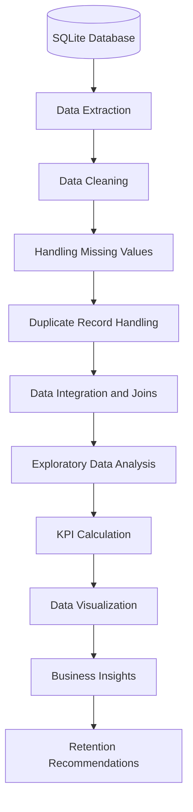

<div align="center">

# 📊 Customer Churn Analysis

### Turning Customer Data into Retention-Focused Business Insights

**Python · SQL · Pandas · NumPy · Matplotlib · Seaborn**


*An exploratory data analysis project investigating customer churn, subscription performance, and customer-support signals.*

</div>

---

## 🧭 Project Overview

Customer churn directly impacts recurring revenue and long-term customer value.

The objective of this project is to analyze customer, subscription, and support data to identify churn patterns, understand customer behavior, and uncover potential retention opportunities.

Using Python, SQL, and exploratory data analysis techniques, I transformed raw relational data into meaningful business metrics and actionable insights.

### 🎯 Business Objectives

- Understand overall customer churn and retention.
- Identify subscription plans with higher churn rates.
- Analyze customer tenure and monthly revenue.
- Investigate the relationship between customer support escalations and churn.
- Identify customer segments that may require retention strategies.

---

## 📌 Key Business Insights

<div align="center">

| KPI | Result |
|:---:|:---:|
| **Overall Churn Rate** | **28.57%** |
| **Customer Retention Rate** | **71.43%** |
| **Average Monthly Charges (ARPU)** | **18.85** |
| **Average Customer Tenure** | **1,572 Days** |
| **Support Escalation Rate** | **19.05%** |
| **Escalation–Churn Correlation** | **0.77** |

</div>

### 📊 Churn Rate by Subscription Plan

| Subscription Plan | Churn Rate |
|:---|---:|
| Basic | 🔴 60.00% |
| Standard | 🟡 22.22% |
| Premium | 🟢 14.29% |

### 🔍 Key Observations

1. **Basic Plan Has the Highest Churn:** The Basic subscription plan records a 60% churn rate, considerably higher than Standard and Premium plans.

2. **Customer Support Matters:** An observed correlation of 0.77 between support escalation status and churn suggests that escalated support cases deserve further investigation.

3. **Revenue Exposure:** Churned customers account for 73.94 in monthly subscription charges.

4. **Retention Opportunity:** Identifying customers with higher churn scores and monitoring support escalations could help prioritize retention efforts.

*Note: These are exploratory findings from a small dataset, not statistically validated business conclusions.*

---

## 🛠️ Tech Stack

| Technology | Application |
|---|---|
| Python | Data analysis and manipulation |
| SQLite | Relational database and SQL queries |
| Pandas | Data cleaning, merging, grouping and aggregation |
| NumPy | Numerical operations and conditional logic |
| Matplotlib | Data visualization |
| Seaborn | Statistical visualization and correlation analysis |
| Jupyter Notebook | Interactive analysis and documentation |

---

## ⚙️ Analytical Workflow



---

## 🧹 Data Cleaning & Preparation

The database consists of three relational tables:

- Customer
- Subscription
- Support

### 1. Customer Data Cleaning

- Renamed `name` to `customer_name` for better readability.
- Removed unused `interests` and `pincode` columns.
- Converted `dob` into datetime format.
- Standardized inconsistent gender values.
- Handled missing country values using a state-to-country mapping derived from existing records.

### 2. Subscription Data Preparation

- Converted subscription start, renewal, and cancellation columns into datetime format.
- Created a binary `churn_flag`:
  - `1` = Customer churned.
  - `0` = Customer retained.

### 3. Support Data Preparation

- Removed unnecessary columns such as `col_1` and `comment`.
- Converted complaint dates into datetime format.
- Identified customers with multiple support records.
- Calculated complaint counts per customer.
- Retained the latest support record for each customer before merging.

### 4. Data Integration & Join Validation

One important challenge was handling duplicate customer IDs in the support table.

The initial merge generated 23 rows because customers with multiple support records appeared more than once.

To prevent inflated customer-level metrics:

- Aggregated complaint counts by customer.
- Sorted support records by complaint date.
- Retained the latest support record per customer.
- Used left joins to combine customer, subscription, and support data.
- Validated row counts and unique customer IDs after merging.

**Final merged dataset: 21 records.**

This validation helps ensure that customer counts, churn rates, and revenue calculations are not distorted by duplicate records.

---

## 📐 Business KPIs & Calculations

| KPI | Calculation |
|---|---|
| Churn Rate | Churned Customers / Total Customers × 100 |
| Retention Rate | 100 − Churn Rate |
| ARPU | Average Monthly Charges |
| Average Tenure | Average Subscription Duration |
| Revenue at Risk | Sum of Monthly Charges for Churned Customers |
| Escalation Rate | Percentage of Customer Records with Escalations |
| Average Complaints | Total Complaints / Unique Customers |

### Customer Risk Segmentation

Customers were categorized using the existing `churn_score`:

| Risk Category | Churn Score |
|---|---|
| Low Risk | Below 50 |
| Medium Risk | 50–69 |
| High Risk | 70 and above |

---

## 📊 Exploratory Data Analysis

The notebook includes the following visualizations:

- Monthly customer churn trend.
- Churn rate by subscription plan.
- Churn rate by state.
- Correlation heatmap.
- Pair plot for numerical variables.
- Monthly charges comparison across plans, gender, and churn-risk segments.
- Pivot tables for customer counts, churn rates, and monthly charges.

### What the Analysis Helps Understand

- Which subscription plan has the highest churn?
- How does customer churn vary across geographical segments?
- Are support escalations associated with customer churn?
- How do monthly charges differ across customer segments?
- Which customers may need additional retention attention?

---

## 💡 Business Recommendations

Based on the exploratory findings, the following actions could be investigated:

### 1. Improve Basic Plan Retention

The Basic plan has the highest observed churn rate.

**Recommendation:**
- Investigate cancellation reasons.
- Review pricing and feature limitations.
- Evaluate customer expectations and plan suitability.

### 2. Monitor Support Escalations

The positive correlation between support escalations and churn suggests that escalated cases may be useful for identifying dissatisfied customers.

**Recommendation:**
- Prioritize unresolved escalated complaints.
- Introduce proactive customer follow-ups.
- Monitor whether faster issue resolution improves retention.

### 3. Introduce Customer Segmentation

Different customer groups may have different retention requirements.

**Recommendation:**
- Monitor customer churn scores.
- Identify high-risk customer segments.
- Develop targeted retention campaigns.

### 4. Track Revenue Exposure

Churned customers represent lost recurring subscription opportunities.

**Recommendation:**
- Monitor monthly recurring charges associated with churn.
- Track customer lifetime value.
- Compare retention campaign costs against retained revenue.

---

## ⚠️ Limitations & Analytical Considerations

A good analysis should also explain what its data cannot prove.

- The final dataset contains only 21 customer/subscription records. Findings are exploratory and cannot be generalized to a larger customer population.
- The support table contains 9 complaint records across 7 unique customers.
- The value of 73.94 represents monthly charges associated with churned customers, not annual revenue loss or lifetime revenue loss.
- The escalation–churn correlation of 0.77 does not establish causation.
- Escalation metrics use the latest support record per customer in the final merged dataset.
- Average tenure for active customers depends on the notebook execution date.
- Country imputation assumes a consistent state-to-country mapping.
- This project focuses on descriptive analysis and does not train a predictive churn model.

---

## 🚀 How to Run This Project

### Prerequisites

- Python 3.x
- Jupyter Notebook
- SQLite database file: `customer_churn.db`

### Step 1: Clone the Repository

```bash
git clone <your-repository-url>
cd customer-churn-analysis
```

### Step 2: Install Dependencies

```bash
pip install pandas numpy matplotlib seaborn jupyter
```

### Step 3: Add the Database

Place `customer_churn.db` in the notebook's working directory.

### Step 4: Launch Jupyter Notebook

```bash
jupyter notebook
```

Open `churn_Analysis.ipynb` and execute the cells sequentially.

---

## 📁 Repository Structure

```text
customer-churn-analysis/
│
├── churn_Analysis.ipynb
├── customer_churn.db
├── exported_churn_data.csv
└── README.md
```

*The notebook exports the final merged dataset as `exported_churn_data.csv`.*

Only publish the database if you have permission to share it and it contains no sensitive customer information.

---

## 🧠 Skills Demonstrated

| Technical Skills | Business Skills |
|---|---|
| Python Programming | Business Problem Understanding |
| SQL & SQLite | Customer Retention Analysis |
| Data Cleaning | KPI Development |
| Data Transformation | Revenue Exposure Analysis |
| Exploratory Data Analysis | Insight Generation |
| Data Visualization | Business Recommendations |
| Data Validation | Analytical Communication |

---

<div align="center">

## 👨‍💻 About This Project

**Customer Churn Analysis**

An independent data analytics portfolio project demonstrating the application of Python, SQL, and exploratory data analysis to a customer retention problem.

**Areas of Interest:** Data Analytics · Business Intelligence · SQL · Python · Data Visualization

⭐ If you find this project useful, consider giving the repository a star!

</div>
